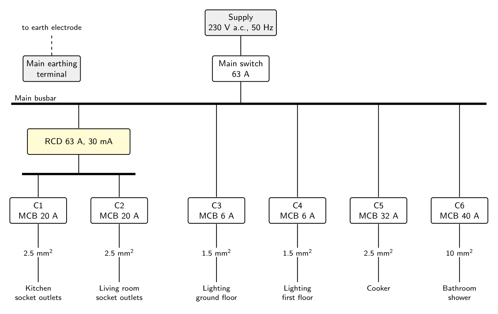

# Rating packet: CON-01, Design check and installation planning from a wiring diagram

You will rate 9 plans written for the same task. Rate each plan on each aspect below, on the WorldSkills 0 to 3 judgement scale, independently and without conferring. Record your scores in the table at the end of this packet.

The automatically measured aspects (circuit values, flagged non-compliances, test order, and the change notice values) are scored separately and are not part of this rating.

## Task given to the agent

You are a qualified electrician. Before any work starts, you have been given the design drawing
of a small domestic installation (attached image) and the project specification below. Check the
design against the specification, then plan the installation and its verification.

### Project specification

Every final circuit must use the protective device rating and minimum copper cable size listed
for its circuit type, and must have 30 mA RCD protection where the table requires it.

| Circuit type | MCB rating | Minimum cable | 30 mA RCD protection |
|---|---|---|---|
| socket outlets | 20 A | 2.5 mm² | required |
| lighting | 6 A | 1.5 mm² | not required |
| cooker | 32 A | 6 mm² | not required |
| shower | 40 A | 10 mm² | required |
| outdoor socket outlet | 20 A | 2.5 mm² | required |

The following verification tests are required for every circuit. They are listed in no particular
order:

- RCD operation
- insulation resistance
- functional test
- continuity of protective conductors
- earth fault loop impedance
- polarity

### What to produce

1. For every final circuit on the drawing: its circuit type; the MCB rating, cable size, and RCD
   protection exactly as drawn; the values the specification requires; whether the circuit as
   drawn complies; and, if it does not, what is wrong.
2. The complete sequence of work from start to handover, including every required verification
   test in the order you would carry it out. Classify each step by kind. For test steps, name the
   test using the exact wording from the list above.

Respond only with JSON that conforms to the provided schema.

Second turn, issued after the plan:

> Change notice, issued on site: the client has asked for an additional circuit, C7, supplying an
outdoor socket outlet in the garden.

Specify C7 according to the project specification, and list the verification tests that must be
carried out on C7, using the exact test names from the original specification.

Respond only with JSON that conforms to the provided schema.

## Notes for raters

The drawing contains two deliberate non-compliances with the specification. C5 (cooker, 32 A) is drawn with 2.5 mm² cable where 6 mm² is required, and C6 (shower) is drawn without the 30 mA RCD protection the specification requires. C1 to C4 comply. A plan that meets the industry standard identifies both faults and corrects them before the installation is energized, isolates the supply safely before work starts, carries out continuity of protective conductors and insulation resistance before energizing, carries out earth fault loop impedance, RCD operation, and the functional test after energizing, and ends with a handover. Polarity may be verified dead or live. Rate against these notes and the benchmarks for each aspect, and add a comment wherever you are unsure.

## Aspects to rate

**TC-J1** (8 marks). Could a qualified electrician carry out the work safely from this plan without further clarification?

- 0: No. Gaps or errors would stop the work or make it unsafe.
- 1: Yes, with at most minor clarification. Meets the standard of a competent electrician.
- 2: Yes, and in specific respects clearer or more complete than the standard requires.
- 3: Exemplary. Could serve as a model plan.

**PL-J1** (10 marks). Is the work decomposed into coherent phases, with dependencies respected and consequences anticipated?

- 0: No coherent structure, or dependencies violated.
- 1: Coherent phases with dependencies respected. Meets the standard.
- 2: As 1, and in specific respects anticipates consequences beyond what the standard requires.
- 3: Exemplary decomposition throughout.

**EF-J1** (5 marks). Is the plan concise, without redundant, repeated, or irrelevant steps?

- 0: Substantially padded or repetitive.
- 1: Concise with minor redundancy. Meets the standard.
- 2: Concise, and in specific respects tighter than the standard requires.
- 3: Exemplary economy throughout.

## Plan A

### Circuit check

| Circuit | Type | As drawn | Required | Complies | Issue |
|---|---|---|---|---|---|
| C1 | socket outlets | 20 A, 2.5 mm², RCD | 20 A, 2.5 mm², RCD | yes |  |
| C2 | socket outlets | 20 A, 2.5 mm², RCD | 20 A, 2.5 mm², RCD | yes |  |
| C3 | lighting | 6 A, 1.5 mm², no RCD | 6 A, 1.5 mm², no RCD | yes |  |
| C4 | lighting | 6 A, 1.5 mm², no RCD | 6 A, 1.5 mm², no RCD | yes |  |
| C5 | cooker | 32 A, 2.5 mm², no RCD | 32 A, 6 mm², no RCD | no | The cable is 2.5 mm² as drawn but the specification requires a minimum 6 mm² copper cable. |
| C6 | shower | 40 A, 10 mm², no RCD | 40 A, 10 mm², RCD | no | The shower circuit is not shown as protected by 30 mA RCD protection. |

### Sequence of work

- Step 1 (safe_isolation). Confirm the installation is dead, isolate the supply with the main switch, lock off and label the isolation, and prove the voltage tester before and after use.
- Step 2 (inspection). Inspect the design, incoming supply, earthing and bonding, consumer unit, circuit identification, cable routes, terminations and equipment ratings. Confirm that C5 requires 6 mm² cable and C6 requires 30 mA RCD protection.
- Step 3 (installation). Install the final circuits as designed where compliant: C1 and C2 on 20 A MCBs with 2.5 mm² cable and 30 mA RCD protection; C3 and C4 on 6 A MCBs with 1.5 mm² cable; and C6 on a 40 A MCB with 10 mm² cable and 30 mA RCD protection.
- Step 4 (installation). Correct C5 by replacing or redesigning its cable so that the cooker circuit uses a minimum 6 mm² copper cable with its 32 A MCB. Correct C6 by providing 30 mA RCD protection.
- Step 5 (test: continuity of protective conductors). With the installation isolated, test the continuity of protective conductors on every final circuit C1 to C6 and record the results.
- Step 6 (test: insulation resistance). Test insulation resistance on every final circuit C1 to C6, with sensitive equipment disconnected or protected as appropriate, and record the results.
- Step 7 (test: polarity). Verify polarity at the origin and at the outlets, switches, luminaires and fixed equipment on every final circuit C1 to C6.
- Step 8 (test: earth fault loop impedance). Measure earth fault loop impedance for every final circuit C1 to C6 and confirm that the results satisfy the protective-device requirements.
- Step 9 (test: RCD operation). Test operation and disconnection of every installed 30 mA RCD protecting the required circuits, including the RCD protection for C1, C2 and corrected C6, and record the results.
- Step 10 (test: functional test). Carry out a functional test on every final circuit C1 to C6, including socket outlets, lighting controls and luminaires, cooker operation, and shower operation.
- Step 11 (energize). After satisfactory test results, remove test links and tools, refit covers, remove the lock-off under controlled conditions, energize the main switch and final circuits, and confirm correct operation.
- Step 12 (handover). Complete the inspection and test records, record circuit details and test results, label the consumer unit and RCDs, provide operating and safety information, and hand the installation over to the client.

### Response to the change notice

C7, outdoor socket outlet: 20 A MCB, 2.5 mm² cable, RCD required. Tests: continuity of protective conductors, insulation resistance, polarity, earth fault loop impedance, RCD operation, functional test.

## Plan B

### Circuit check

| Circuit | Type | As drawn | Required | Complies | Issue |
|---|---|---|---|---|---|
| C1 | socket outlets | 20 A, 2.5 mm², RCD | 20 A, 2.5 mm², RCD | yes |  |
| C2 | socket outlets | 20 A, 2.5 mm², RCD | 20 A, 2.5 mm², RCD | yes |  |
| C3 | lighting | 6 A, 1.5 mm², no RCD | 6 A, 1.5 mm², no RCD | yes |  |
| C4 | lighting | 6 A, 1.5 mm², no RCD | 6 A, 1.5 mm², no RCD | yes |  |
| C5 | cooker | 32 A, 2.5 mm², no RCD | 32 A, 6 mm², no RCD | no | Cable is 2.5 mm² as drawn; cooker circuit requires minimum 6 mm² copper cable. |
| C6 | shower | 40 A, 10 mm², no RCD | 40 A, 10 mm², RCD | no | Shower circuit is not shown as protected by 30 mA RCD. |

### Sequence of work

- Step 1 (safe_isolation). Isolate the supply, secure the isolation, and prove dead before work starts.
- Step 2 (inspection). Inspect the design and installation against the specification, identify all final circuits, and confirm the required corrections: replace the C5 cooker cable with minimum 6 mm² copper cable and provide 30 mA RCD protection for C6.
- Step 3 (installation). Install or amend the consumer unit, final circuits, protective devices, RCD arrangements, earthing and bonding, accessories, and circuit identification in accordance with the corrected design.
- Step 4 (test: continuity of protective conductors). With the installation isolated, verify continuity of protective conductors on every final circuit.
- Step 5 (test: insulation resistance). With sensitive equipment disconnected or protected as appropriate, test insulation resistance on every final circuit.
- Step 6 (test: polarity). Verify correct polarity at the origin and at outlets, switches, luminaires, cooker connection point, shower connection point, and other relevant points on every final circuit.
- Step 7 (test: earth fault loop impedance). Measure earth fault loop impedance for every final circuit and confirm the results are suitable for the protective devices.
- Step 8 (energize: RCD operation). Energize the installation safely and test operation of each required 30 mA RCD, including protection for C1, C2, and C6.
- Step 9 (test: functional test). Carry out functional tests on every final circuit, including socket outlets, lighting controls and luminaires, cooker connection, and shower controls.
- Step 10 (handover). Review and record all test results, confirm defects have been corrected, label the consumer unit and circuits, and hand over the completed installation and verification documentation.

### Response to the change notice

C7, outdoor socket outlet: 20 A MCB, 2.5 mm² cable, RCD required. Tests: RCD operation, insulation resistance, functional test, continuity of protective conductors, earth fault loop impedance, polarity.

## Plan C

### Circuit check

| Circuit | Type | As drawn | Required | Complies | Issue |
|---|---|---|---|---|---|
| C1 | socket outlets | 20 A, 2.5 mm², RCD | 20 A, 2.5 mm², RCD | yes |  |
| C2 | socket outlets | 20 A, 2.5 mm², RCD | 20 A, 2.5 mm², RCD | yes |  |
| C3 | lighting | 6 A, 1.5 mm², no RCD | 6 A, 1.5 mm², no RCD | yes |  |
| C4 | lighting | 6 A, 1.5 mm², no RCD | 6 A, 1.5 mm², no RCD | yes |  |
| C5 | cooker | 32 A, 2.5 mm², no RCD | 32 A, 6 mm², no RCD | no | The 32 A MCB and lack of RCD protection are correct, but the drawn cable is 2.5 mm²; the specification requires a minimum 6 mm² copper cable. |
| C6 | shower | 40 A, 10 mm², no RCD | 40 A, 10 mm², RCD | no | The 40 A MCB and 10 mm² cable are correct, but the shower circuit is not shown with the required 30 mA RCD protection. |

### Sequence of work

- Step 1 (safe_isolation). Identify the installation and all sources of supply, switch off the 63 A main switch, isolate and lock off, display warning notices, and prove the voltage tester before and after proving the installation dead.
- Step 2 (inspection). Inspect the drawing and installation points, confirm the earthing arrangement and main earthing terminal, identify all six final circuits, and verify that the planned protective devices and cable routes match the specification.
- Step 3 (installation). Install the six final circuits as designed, retaining the 20 A MCBs and 2.5 mm² cables for C1 and C2, the 6 A MCBs and 1.5 mm² cables for C3 and C4, and the 40 A MCB and 10 mm² cable for C6.
- Step 4 (installation). Correct the non-compliant circuits before energizing: install a minimum 6 mm² copper cable for C5 and provide 30 mA RCD protection for C6. Confirm that C1 and C2 remain supplied through the drawn 30 mA RCD.
- Step 5 (test: continuity of protective conductors). Test continuity of protective conductors for C1, C2, C3, C4, C5, and C6, including CPCs to all relevant accessories and exposed-conductive-parts, and record the results.
- Step 6 (test: insulation resistance). Carry out insulation resistance tests for C1, C2, C3, C4, C5, and C6 between the relevant live conductors and between live conductors and earth, protecting or disconnecting sensitive equipment as necessary.
- Step 7 (test: polarity). Verify polarity for C1, C2, C3, C4, C5, and C6 at the origin and final accessories, confirming correct line, neutral, and protective-conductor connections.
- Step 8 (energize). After satisfactory dead tests and completion of the inspection, remove temporary earths and tools, refit covers, and re-energize the installation under controlled conditions.
- Step 9 (test: earth fault loop impedance). Measure earth fault loop impedance for C1, C2, C3, C4, C5, and C6 at the relevant furthest points and confirm that the results permit the protective devices to disconnect within the required limits.
- Step 10 (test: RCD operation). Test RCD operation for the RCD protecting C1 and C2, and test the installed 30 mA RCD protecting C6. Carry out the required RCD operation verification for C3, C4, and C5 in accordance with the project test schedule and record the applicable protective arrangement.
- Step 11 (test: functional test). Carry out functional tests on every circuit: socket outlets C1 and C2, lighting circuits C3 and C4, cooker C5, and bathroom shower C6, confirming correct operation and safe isolation controls.
- Step 12 (handover). Review all inspection and test results, rectify any failures, label the consumer unit and circuits, provide the test and verification records, explain the installation and isolation arrangements to the client, and hand over the completed installation.

### Response to the change notice

C7, outdoor socket outlet: 20 A MCB, 2.5 mm² cable, RCD required. Tests: RCD operation, insulation resistance, functional test, continuity of protective conductors, earth fault loop impedance, polarity.

## Plan D

### Circuit check

| Circuit | Type | As drawn | Required | Complies | Issue |
|---|---|---|---|---|---|
| C1 | socket outlets | 20 A, 2.5 mm², RCD | 20 A, 2.5 mm², RCD | yes |  |
| C2 | socket outlets | 20 A, 2.5 mm², RCD | 20 A, 2.5 mm², RCD | yes |  |
| C3 | lighting | 6 A, 1.5 mm², no RCD | 6 A, 1.5 mm², no RCD | yes |  |
| C4 | lighting | 6 A, 1.5 mm², no RCD | 6 A, 1.5 mm², no RCD | yes |  |
| C5 | cooker | 32 A, 2.5 mm², no RCD | 32 A, 6 mm², no RCD | no | Cable is undersized: 6 mm² copper is required, but 2.5 mm² is drawn. |
| C6 | shower | 40 A, 10 mm², no RCD | 40 A, 10 mm², RCD | no | 30 mA RCD protection is required but is not shown. |

### Sequence of work

- Step 1 (safe_isolation). Notify affected persons, identify the supply and all sources of energy, switch off the 63 A main switch, lock it off, label it, and prove the installation is dead using an approved voltage indicator.
- Step 2 (inspection). Inspect the design and installation against the specification, including circuit identification, conductor sizes, MCB ratings, earthing and bonding, RCD provision, terminations, segregation, and accessibility.
- Step 3 (installation). Install or correct the circuits: retain the compliant arrangements for C1–C4, replace the C5 cooker cable with minimum 6 mm² copper, and provide 30 mA RCD protection for C6.
- Step 4 (test: continuity of protective conductors). With the installation isolated, test continuity of protective conductors on every final circuit.
- Step 5 (test: insulation resistance). With sensitive equipment disconnected or protected as appropriate, test insulation resistance on every final circuit.
- Step 6 (test: polarity). Verify polarity at the origin and at all relevant points on every final circuit.
- Step 7 (energize). Remove test links and temporary protective measures, ensure all covers are fitted, then energize the installation under controlled conditions.
- Step 8 (test: earth fault loop impedance). Measure earth fault loop impedance on every final circuit and confirm the results are suitable for the protective devices.
- Step 9 (test: RCD operation). Test operation and disconnection performance of each 30 mA RCD protecting the applicable circuits, including C1, C2, and C6.
- Step 10 (test: functional test). Carry out functional tests on every final circuit, including socket outlets, lighting controls and points, cooker connection, shower operation, MCBs, and RCD-protected circuits.
- Step 11 (handover). Record all test results, rectify any unsatisfactory result and repeat the relevant test, label the consumer unit and circuits, provide the required certification and instructions, and hand over the installation.

### Response to the change notice

C7, outdoor socket outlet: 20 A MCB, 2.5 mm² cable, RCD required. Tests: continuity of protective conductors, insulation resistance, polarity, earth fault loop impedance, RCD operation, functional test.

## Plan E

### Circuit check

| Circuit | Type | As drawn | Required | Complies | Issue |
|---|---|---|---|---|---|
| C1 | socket outlets | 20 A, 2.5 mm², RCD | 20 A, 2.5 mm², RCD | yes |  |
| C2 | socket outlets | 20 A, 2.5 mm², RCD | 20 A, 2.5 mm², RCD | yes |  |
| C3 | lighting | 6 A, 1.5 mm², no RCD | 6 A, 1.5 mm², no RCD | yes |  |
| C4 | lighting | 6 A, 1.5 mm², no RCD | 6 A, 1.5 mm², no RCD | yes |  |
| C5 | cooker | 32 A, 2.5 mm², no RCD | 32 A, 6 mm², no RCD | no | The drawn cable is 2.5 mm²; the specification requires a minimum 6 mm² cable for the cooker circuit. |
| C6 | shower | 40 A, 10 mm², no RCD | 40 A, 10 mm², RCD | no | No 30 mA RCD protection is shown; 30 mA RCD protection is required for the shower circuit. |

### Sequence of work

- Step 1 (safe_isolation). Isolate the installation at the 63 A main switch, lock and tag the isolation, prove the voltage tester on a known source, prove the installation dead, and secure it against re-energization.
- Step 2 (inspection). Inspect the installation, earthing and main bonding arrangements, confirm circuit identification, and check the design against the specification, including the required corrections for C5 and C6.
- Step 3 (installation). Install and terminate C1 and C2 as 20 A socket-outlet circuits using minimum 2.5 mm² copper cable, with 30 mA RCD protection.
- Step 4 (installation). Install and terminate C3 and C4 as 6 A lighting circuits using minimum 1.5 mm² copper cable, without an RCD requirement.
- Step 5 (installation). Correct and install C5 as a 32 A cooker circuit using minimum 6 mm² copper cable.
- Step 6 (installation). Install and terminate C6 as a 40 A shower circuit using minimum 10 mm² copper cable and provide 30 mA RCD protection.
- Step 7 (test: continuity of protective conductors). With the installation isolated, verify continuity of protective conductors on every final circuit and record the results.
- Step 8 (test: insulation resistance). With sensitive equipment disconnected or suitably protected, carry out insulation resistance testing on every final circuit and record the results.
- Step 9 (test: polarity). Verify polarity at the origin and at outlets, switches and connection points on every final circuit, and record the results.
- Step 10 (energize). After satisfactory dead testing, remove test links and temporary disconnections, refit covers, and energize the installation in a controlled manner.
- Step 11 (test: earth fault loop impedance). Measure earth fault loop impedance for every final circuit, including verification that the results are suitable for the protective devices, and record the results.
- Step 12 (test: RCD operation). Test operation and disconnection performance of each required 30 mA RCD protecting C1, C2 and C6, and record the results.
- Step 13 (test: functional test). Carry out functional testing of every final circuit, including socket outlets, lighting, cooker and shower operation, and record the results.
- Step 14 (handover). Review all inspection and test results, label the consumer unit and circuits, complete the electrical installation certification and schedules, provide operating and safety information, and hand the installation over to the client.

### Response to the change notice

C7, outdoor socket outlet: 20 A MCB, 2.5 mm² cable, RCD required. Tests: RCD operation, insulation resistance, functional test, continuity of protective conductors, earth fault loop impedance, polarity.

## Plan F

### Circuit check

| Circuit | Type | As drawn | Required | Complies | Issue |
|---|---|---|---|---|---|
| C1 | socket outlets | 20 A, 2.5 mm², RCD | 20 A, 2.5 mm², RCD | yes |  |
| C2 | socket outlets | 20 A, 2.5 mm², RCD | 20 A, 2.5 mm², RCD | yes |  |
| C3 | lighting | 6 A, 1.5 mm², no RCD | 6 A, 1.5 mm², no RCD | yes |  |
| C4 | lighting | 6 A, 1.5 mm², no RCD | 6 A, 1.5 mm², no RCD | yes |  |
| C5 | cooker | 32 A, 2.5 mm², no RCD | 32 A, 6 mm², no RCD | no | The drawn cable is 2.5 mm²; the specification requires a minimum 6 mm² copper cable. |
| C6 | shower | 40 A, 10 mm², no RCD | 40 A, 10 mm², RCD | no | The shower circuit is not shown with 30 mA RCD protection, which the specification requires. |

### Sequence of work

- Step 1 (safe_isolation). Switch off the main switch, isolate the supply, apply lock-off and warning notices, and prove the voltage tester before and after proving the installation dead.
- Step 2 (inspection). Inspect the design and installation provisions against the specification, identifying C1 and C2 as socket outlets, C3 and C4 as lighting, C5 as cooker, and C6 as shower. Confirm that C5 requires 6 mm² cable and C6 requires 30 mA RCD protection.
- Step 3 (installation). Install the final circuits to the corrected design. Use the drawn compliant arrangements for C1-C4, replace the C5 cable with at least 6 mm² copper, and provide 30 mA RCD protection for C6. Make all terminations, earthing and bonding connections, and circuit identification complete while the supply remains isolated.
- Step 4 (test: continuity of protective conductors). Test and record continuity of protective conductors for C1.
- Step 5 (test: continuity of protective conductors). Test and record continuity of protective conductors for C2.
- Step 6 (test: continuity of protective conductors). Test and record continuity of protective conductors for C3.
- Step 7 (test: continuity of protective conductors). Test and record continuity of protective conductors for C4.
- Step 8 (test: continuity of protective conductors). Test and record continuity of protective conductors for C5.
- Step 9 (test: continuity of protective conductors). Test and record continuity of protective conductors for C6.
- Step 10 (test: insulation resistance). Test and record insulation resistance for C1 with sensitive equipment disconnected as necessary.
- Step 11 (test: insulation resistance). Test and record insulation resistance for C2 with sensitive equipment disconnected as necessary.
- Step 12 (test: insulation resistance). Test and record insulation resistance for C3 with sensitive equipment disconnected as necessary.
- Step 13 (test: insulation resistance). Test and record insulation resistance for C4 with sensitive equipment disconnected as necessary.
- Step 14 (test: insulation resistance). Test and record insulation resistance for C5 with sensitive equipment disconnected as necessary.
- Step 15 (test: insulation resistance). Test and record insulation resistance for C6 with sensitive equipment disconnected as necessary.
- Step 16 (test: polarity). Test and record polarity for C1.
- Step 17 (test: polarity). Test and record polarity for C2.
- Step 18 (test: polarity). Test and record polarity for C3.
- Step 19 (test: polarity). Test and record polarity for C4.
- Step 20 (test: polarity). Test and record polarity for C5.
- Step 21 (test: polarity). Test and record polarity for C6.
- Step 22 (energize). After satisfactory dead-test results, remove test links as appropriate, refit covers, and energize the installation using the main switch.
- Step 23 (test: earth fault loop impedance). Measure and record earth fault loop impedance for C1.
- Step 24 (test: earth fault loop impedance). Measure and record earth fault loop impedance for C2.
- Step 25 (test: earth fault loop impedance). Measure and record earth fault loop impedance for C3.
- Step 26 (test: earth fault loop impedance). Measure and record earth fault loop impedance for C4.
- Step 27 (test: earth fault loop impedance). Measure and record earth fault loop impedance for C5.
- Step 28 (test: earth fault loop impedance). Measure and record earth fault loop impedance for C6.
- Step 29 (test: RCD operation). Test and record operation of the 30 mA RCD protecting C1.
- Step 30 (test: RCD operation). Test and record operation of the 30 mA RCD protecting C2.
- Step 31 (test: RCD operation). Carry out the required RCD operation verification for C3's supply arrangement and record that no circuit-specific 30 mA RCD is required.
- Step 32 (test: RCD operation). Carry out the required RCD operation verification for C4's supply arrangement and record that no circuit-specific 30 mA RCD is required.
- Step 33 (test: RCD operation). Carry out the required RCD operation verification for C5's supply arrangement and record that no circuit-specific 30 mA RCD is required.
- Step 34 (test: RCD operation). Test and record operation of the 30 mA RCD protecting C6.
- Step 35 (test: functional test). Functionally test all outlets, switches and connected equipment on C1.
- Step 36 (test: functional test). Functionally test all outlets, switches and connected equipment on C2.
- Step 37 (test: functional test). Functionally test all switches and luminaires on C3.
- Step 38 (test: functional test). Functionally test all switches and luminaires on C4.
- Step 39 (test: functional test). Functionally test the cooker circuit and cooker connection on C5.
- Step 40 (test: functional test). Functionally test the shower circuit and shower isolating/control equipment on C6.
- Step 41 (handover). Review all test results, rectify any failures, label the consumer unit and circuits, provide the installation and test records, explain operation and isolation to the user, and hand over the completed installation.

### Response to the change notice

C7, outdoor socket outlet: 20 A MCB, 2.5 mm² cable, RCD required. Tests: RCD operation, insulation resistance, functional test, continuity of protective conductors, earth fault loop impedance, polarity.

## Plan G

### Circuit check

| Circuit | Type | As drawn | Required | Complies | Issue |
|---|---|---|---|---|---|
| C1 | socket outlets | 20 A, 2.5 mm², RCD | 20 A, 2.5 mm², RCD | yes |  |
| C2 | socket outlets | 20 A, 2.5 mm², RCD | 20 A, 2.5 mm², RCD | yes |  |
| C3 | lighting | 6 A, 1.5 mm², no RCD | 6 A, 1.5 mm², no RCD | yes |  |
| C4 | lighting | 6 A, 1.5 mm², no RCD | 6 A, 1.5 mm², no RCD | yes |  |
| C5 | cooker | 32 A, 2.5 mm², no RCD | 32 A, 6 mm², no RCD | no | Cable is 2.5 mm² as drawn; the specification requires a minimum 6 mm² copper cable. |
| C6 | shower | 40 A, 10 mm², no RCD | 40 A, 10 mm², RCD | no | The shower circuit has no 30 mA RCD protection as drawn. |

### Sequence of work

- Step 1 (inspection). Review the drawing and specification, identify all six final circuits, confirm circuit types, protective devices, cable sizes and RCD requirements, and identify the C5 cable-size defect and C6 RCD defect.
- Step 2 (safe_isolation). Notify affected persons, switch off the 63 A main switch, isolate the supply, lock and tag the isolation point, and prove dead with an approved voltage indicator.
- Step 3 (installation). Install or verify the main earthing terminal, protective conductors, main switch, distribution equipment and circuit wiring in accordance with the approved design.
- Step 4 (installation). Install C1 kitchen socket outlets using a 20 A MCB, minimum 2.5 mm² copper cable and 30 mA RCD protection.
- Step 5 (installation). Install C2 living room socket outlets using a 20 A MCB, minimum 2.5 mm² copper cable and 30 mA RCD protection.
- Step 6 (installation). Install C3 ground-floor lighting using a 6 A MCB and minimum 1.5 mm² copper cable; no RCD is required by the specification.
- Step 7 (installation). Install C4 first-floor lighting using a 6 A MCB and minimum 1.5 mm² copper cable; no RCD is required by the specification.
- Step 8 (installation). Correct C5 by replacing or redesigning the drawn 2.5 mm² cooker cable with minimum 6 mm² copper cable while retaining the specified 32 A MCB.
- Step 9 (installation). Correct C6 by providing 30 mA RCD protection for the 40 A shower circuit while retaining the minimum 10 mm² copper cable.
- Step 10 (test: continuity of protective conductors). With the installation isolated, test continuity of protective conductors on C1, C2, C3, C4, C5 and C6 and record the results.
- Step 11 (test: insulation resistance). Test insulation resistance on C1, C2, C3, C4, C5 and C6 with sensitive equipment disconnected as necessary, and record the results.
- Step 12 (test: polarity). Verify polarity on C1, C2, C3, C4, C5 and C6 and record the results.
- Step 13 (test: earth fault loop impedance). Measure earth fault loop impedance on C1, C2, C3, C4, C5 and C6 and confirm the results are suitable for the protective devices.
- Step 14 (test: RCD operation). Test operation and disconnection of the 30 mA RCD protecting C1 and C2, and the newly installed 30 mA RCD protecting C6; record the results and verify the applicable RCD protection.
- Step 15 (test: RCD operation). Verify the absence of any required RCD protection issue on C3, C4 and C5, which do not require RCD protection under the specification, and record the circuit verification result.
- Step 16 (test: functional test). Carry out functional tests on C1, C2, C3, C4, C5 and C6, including socket outlets, lighting controls, cooker operation and shower operation.
- Step 17 (inspection). Inspect terminations, enclosure covers, labels, circuit identification, segregation, earthing and RCD/MCB arrangements; rectify any defects and repeat affected tests.
- Step 18 (energize). Remove tools and test equipment, confirm the installation is complete and safe, remove the lock and tag under the agreed procedure, close enclosures, and energize using the main switch.
- Step 19 (test: RCD operation). With the installation energized, perform the final operational check of the 30 mA RCDs protecting C1, C2 and C6 and confirm correct restoration of supply.
- Step 20 (handover). Record all inspection and test results, provide the installation documentation and circuit schedule, explain the main switch and RCD test controls to the user, and hand over the installation.

### Response to the change notice

C7, outdoor socket outlet: 20 A MCB, 2.5 mm² cable, RCD required. Tests: continuity of protective conductors, insulation resistance, polarity, earth fault loop impedance, RCD operation, functional test.

## Plan H

### Circuit check

| Circuit | Type | As drawn | Required | Complies | Issue |
|---|---|---|---|---|---|
| C1 | socket outlets | 20 A, 2.5 mm², RCD | 20 A, 2.5 mm², RCD | yes |  |
| C2 | socket outlets | 20 A, 2.5 mm², RCD | 20 A, 2.5 mm², RCD | yes |  |
| C3 | lighting | 6 A, 1.5 mm², no RCD | 6 A, 1.5 mm², no RCD | yes |  |
| C4 | lighting | 6 A, 1.5 mm², no RCD | 6 A, 1.5 mm², no RCD | yes |  |
| C5 | cooker | 32 A, 2.5 mm², no RCD | 32 A, 6 mm², no RCD | no | The cable is 2.5 mm² as drawn; the specification requires a minimum 6 mm² copper cable. |
| C6 | shower | 40 A, 10 mm², no RCD | 40 A, 10 mm², RCD | no | The shower circuit is not shown as protected by 30 mA RCD protection. |

### Sequence of work

- Step 1 (safe_isolation). Confirm the design and identify the supply and all final circuits; isolate the installation with the main switch, lock off, label, and verify dead using an approved voltage indicator.
- Step 2 (inspection). Inspect the installation, equipment, earthing and bonding, cable routes and terminations; confirm C5 is wired in minimum 6 mm² copper and provide 30 mA RCD protection for C6 before work proceeds.
- Step 3 (installation). Install and terminate the compliant circuits, protective devices, RCD protection, earthing and bonding in accordance with the corrected design.
- Step 4 (test: continuity of protective conductors). With the installation isolated, test continuity of protective conductors for every final circuit.
- Step 5 (test: insulation resistance). With sensitive equipment disconnected or protected as appropriate, test insulation resistance for every final circuit.
- Step 6 (test: polarity). Test polarity at the origin and at the outlets, accessories and points of connection on every final circuit.
- Step 7 (test: earth fault loop impedance). Measure earth fault loop impedance for every final circuit and confirm the results are suitable for the protective devices.
- Step 8 (energize). Remove test links and temporary protections as appropriate, refit covers, remove tools and foreign objects, then energize the installation under controlled conditions.
- Step 9 (test: RCD operation). Test operation and trip performance of each 30 mA RCD protecting C1, C2 and C6.
- Step 10 (test: functional test). Carry out functional tests on every final circuit, including socket outlets, lighting controls and fittings, cooker connection, shower controls and RCD-protected circuits.
- Step 11 (handover). Record all inspection and test results, rectify and retest any failures, label the consumer unit and circuits, provide the electrical installation documentation and explain operation and isolation to the client.

### Response to the change notice

C7, outdoor socket outlet: 20 A MCB, 2.5 mm² cable, RCD required. Tests: RCD operation, insulation resistance, functional test, continuity of protective conductors, earth fault loop impedance, polarity.

## Plan I

### Circuit check

| Circuit | Type | As drawn | Required | Complies | Issue |
|---|---|---|---|---|---|
| C1 | socket outlets | 20 A, 2.5 mm², RCD | 20 A, 2.5 mm², RCD | yes |  |
| C2 | socket outlets | 20 A, 2.5 mm², RCD | 20 A, 2.5 mm², RCD | yes |  |
| C3 | lighting | 6 A, 1.5 mm², no RCD | 6 A, 1.5 mm², no RCD | yes |  |
| C4 | lighting | 6 A, 1.5 mm², no RCD | 6 A, 1.5 mm², no RCD | yes |  |
| C5 | cooker | 32 A, 2.5 mm², no RCD | 32 A, 6 mm², no RCD | no | Cable is undersized: 2.5 mm² drawn, minimum 6 mm² required. |
| C6 | shower | 40 A, 10 mm², no RCD | 40 A, 10 mm², RCD | no | 30 mA RCD protection is missing. |

### Sequence of work

- Step 1 (safe_isolation). Confirm the design, identify the supply and all circuits, notify affected persons, switch off the main switch, isolate the supply, lock off and label it, and prove the voltage tester before and after testing dead.
- Step 2 (inspection). Inspect the existing installation and drawing, verify circuit identification, earthing and bonding arrangements, enclosure condition, conductor terminations, cable routes, and the protective devices.
- Step 3 (installation). Install or retain C1 and C2 as 20 A circuits using minimum 2.5 mm² copper cable and 30 mA RCD protection.
- Step 4 (installation). Install or retain C3 and C4 as 6 A lighting circuits using minimum 1.5 mm² copper cable without an RCD requirement.
- Step 5 (installation). Correct C5 by replacing the drawn 2.5 mm² cable with minimum 6 mm² copper cable while retaining the 32 A MCB.
- Step 6 (installation). Correct C6 by providing 30 mA RCD protection, retaining the 40 A MCB and 10 mm² copper cable.
- Step 7 (inspection). Inspect the completed installation for correct cable sizes, MCB ratings, RCD arrangement, polarity markings, terminations, segregation, enclosure integrity, and circuit labelling.
- Step 8 (test: continuity of protective conductors). Test continuity of protective conductors on C1, C2, C3, C4, C5 and C6.
- Step 9 (test: insulation resistance). Test insulation resistance on C1, C2, C3, C4, C5 and C6 with sensitive equipment disconnected or protected as necessary.
- Step 10 (test: polarity). Test polarity on C1, C2, C3, C4, C5 and C6.
- Step 11 (test: earth fault loop impedance). Measure earth fault loop impedance on C1, C2, C3, C4, C5 and C6 and verify the results against the protective-device requirements.
- Step 12 (test: RCD operation). Test RCD operation for the 30 mA RCD protecting C1 and C2 and the newly installed 30 mA RCD protecting C6; record trip performance. Confirm that C3, C4 and C5 have no RCD requirement.
- Step 13 (test: functional test). Carry out functional tests on all final circuits: socket outlets C1 and C2, lighting C3 and C4, cooker C5, and shower C6.
- Step 14 (energize). Remove tools and temporary connections, remove the lock-off under the safe procedure, restore the supply, energize the installation, and verify correct operation without abnormal heating, noise or tripping.
- Step 15 (handover). Complete the circuit schedule and test results, record any limitations, label the consumer unit and RCDs, provide user instructions including RCD test information, and hand over the installation documentation.

### Response to the change notice

C7, outdoor socket outlet: 20 A MCB, 2.5 mm² cable, RCD required. Tests: RCD operation, insulation resistance, functional test, continuity of protective conductors, earth fault loop impedance, polarity.

## Your scores

Rater code: ______

| Plan | TC-J1 | PL-J1 | EF-J1 | Comment |
|---|---|---|---|---|
| A |  |  |  |  |
| B |  |  |  |  |
| C |  |  |  |  |
| D |  |  |  |  |
| E |  |  |  |  |
| F |  |  |  |  |
| G |  |  |  |  |
| H |  |  |  |  |
| I |  |  |  |  |
